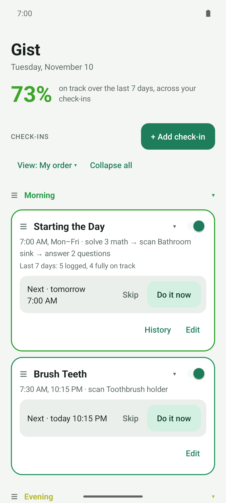
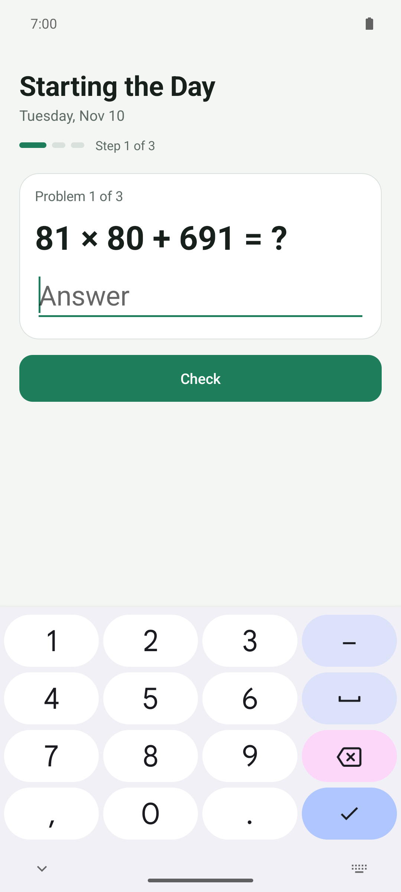
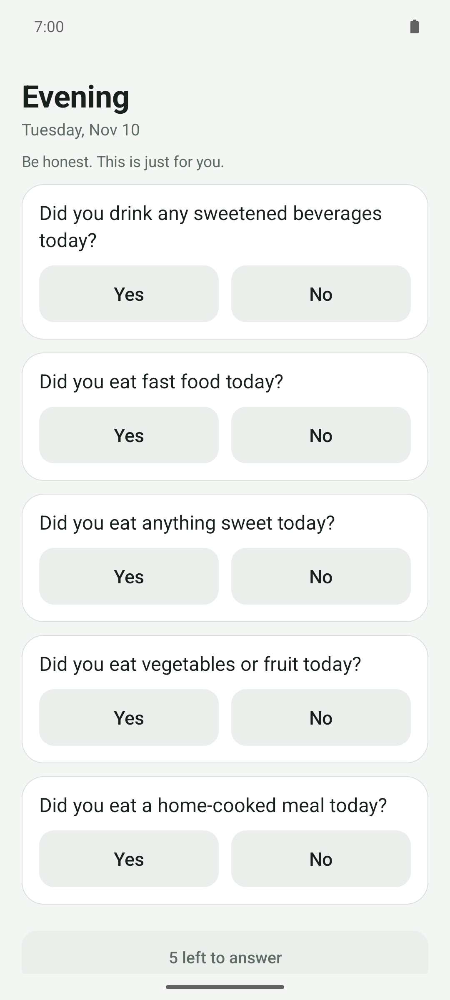
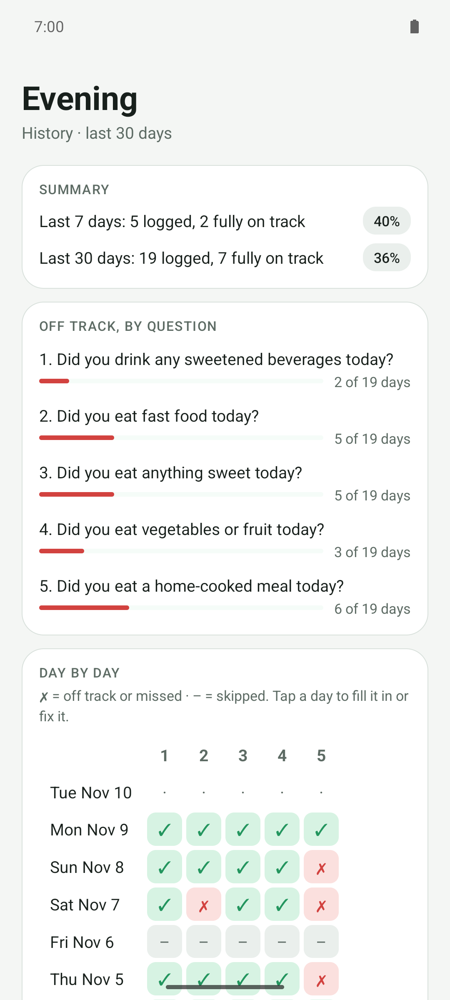

# Gist

**Alarms that make you follow through.**

Gist is an Android app for the habits you mean to keep. Each habit is a **check-in**: it
goes off at the right moment and doesn't stop until you've done what it asks. That might
be answering honestly whether you had the soda, solving math problems to prove you're
awake, or walking to the bathroom sink to scan the code taped there. It keeps a simple
log, so you see the *gist* of how you're doing without counting anything.

## Why it exists

Most habit apps run on willpower. A habit tracker only works if you remember to open it
and you're honest when you do. An alarm you can dismiss only works if you get up instead
of tapping it away half asleep. Both ask the most of you at the moment you have the
least to give.

Gist moves that work to a better moment. You decide **once**, while you're thinking
clearly, what you'll be held to and when. After that, the app does the holding. It
started as a replacement for Alarmy, the alarm that won't turn off until you complete a
task. Gist takes the same idea beyond waking up to any habit, and adds a log so you can
see whether it's working.

It deliberately isn't precise. There are no calories, macros or streak counters, just
yes/no questions with an "on track" answer, and a score from red to green that shows how
the last week went.

## How it works

A check-in is three choices:

1. **When it goes off.** Choose one or more triggers:
   - **times**, with their own days, like "4:00 AM on Tuesdays, 4:45 AM other days";
   - **arriving at or leaving a place**, like the gym;
   - **starting or finishing a run**, or **partway into a run**, like 30 minutes in.

   Triggers can have conditions: only on certain days, only between two times, only when
   you're at or away from a place, at most once a day.
2. **What it takes to stop it.** Add steps, in any order, as many as you like:
   - **math problems**, from easy to very hard;
   - **scan a code**: a QR code or barcode you've registered, so you have to get up and go
     to it;
   - **yes/no questions**: these answers are what Gist logs, like "Did you have a soda
     today?".

   With no steps, it's a plain alarm with a Dismiss button.
3. **How firmly it holds you.**
   - **Strict** (the default): only finishing the steps stops it. There's no snooze, Back
     does nothing, and if you leave the app it comes straight back. It counts in your
     scores.
   - **Soft**: Snooze and Dismiss are allowed and the steps are optional. For nudges, not
     commitments. Not counted.
   - **Voice**: no alarm at all. It says a line, typed or recorded, through your
     headphones. Not counted.

Answers build a history for each check-in: a ✓/✗ grid, which questions slip most, and an
**on-track score** that colors each check-in, each group and the whole start page from red
to green.

## What you can do with it

- **Actually wake up.** Weekdays at 6:00: ten hard math problems, then scan the code on
  the coffee maker. A gentler version for weekends.
- **Eat the way you meant to.** At 9:30 PM: "Soda today? Dessert? Second helpings?" A
  morning check-in about last night's snacking logs to the right day.
- **Take your medication.** At 8 AM, scan the barcode on the bottle, which means you're
  standing next to it.
- **Show up at the gym.** When you arrive on Monday, Wednesday or Friday morning: "Did you
  stretch first?" When you leave: "Did you log your lifts?"
- **Recover after a run.** When you finish a run of at least 20 minutes: "Water?
  Stretch?"
- **Get heckled mid-run.** Voice lines in your earbuds: 15 minutes in, *"hah, he thinks he's
  something"*; an hour in, *"is that Forrest Gump?"*; two hours in, *"ahhh, he's training
  for Boston."* Record them yourself, or have your family do it.
- **Nudge, don't nag.** Soft check-ins for stand-and-stretch on work days or reading
  before bed. Snooze them freely; they stay out of your scores.
- **Run the monthly chores.** A money check on the 1st, bills on the 15th and the last
  day of the month.

The start page shows them all, colored by score. Group them by category, sort them by
next alarm or by what needs attention, and fold the ones you don't need to see.

A library of ready-made check-ins (Food, Wake-up, Health, Fitness, Mind, Money) gets you
started. Copy one and adjust it, or start from scratch.

## Private by design

- **No internet permission.** Nothing leaves your phone, including your location and
  steps. There are no accounts, ads or analytics.
- Your data stays in the app's private storage. It leaves only when you export it: a
  readable YAML backup (pick which check-ins, with or without history) or a CSV of your
  answers.
- It uses only Android's built-in APIs plus two small open-source libraries: ZXing for
  scanning and SnakeYAML Engine for backups.

It can't stop you from force-stopping or uninstalling it. The friction is the point.

## Get it

Gist runs on **Android 10 or newer**.

1. Download the latest `.apk` from [**Releases**](https://github.com/gohenderson/gist-accountability/releases)
   (the newest "Gist for Android").
   Each release has a `.sha256` checksum next to it.
2. Open it on your phone, and allow "Install unknown apps" for your browser or file
   manager when Android asks.
3. Follow the start page's **Finish setup** card to grant what alarms need, then tap a
   check-in's **Test** button and lock your phone.

Or [build it yourself](BUILDING.md).

**iPhone:** a version for iOS 26 is in progress. It already has check-ins, alarms (soft ones
with snooze), math, questions and camera scan steps, places (arrive, leave, at or away),
the check-in library, history, scores and backups that move between phones, on iPhone and
iPad, with photo, slideshow and video backgrounds. Not yet: run triggers and voice check-ins
([what's different](USER_GUIDE.md#on-iphone-and-ipad)). Until
it's in the App Store, you can install it with your own Apple ID, no Mac needed
([how](BUILDING.md#on-your-iphone-or-ipad-without-a-mac)).

## Documentation

| Document | What's in it |
|---|---|
| [User guide](USER_GUIDE.md) | Every feature in detail: first-run setup, triggers, places, running, steps, commitment, the ringing screen, history and scores, backups and settings |
| [Building](BUILDING.md) | Building and installing from source with Android Studio or Gradle |
| [Testing](TESTING.md) | The unit and UI test suites, what they cover, and how to run them |
| [Releasing](RELEASING.md) | The GitHub Actions workflows, signed releases, the one-time signing key setup, and screenshots |
| [Security](SECURITY.md) | Reporting a vulnerability, and the automated dependency and code scanning |
| [Architecture](ARCHITECTURE.md) | How the code is organized, file by file, and the design choices behind it |

Found a bug or have an idea? [Open an issue](https://github.com/gohenderson/gist-accountability/issues).

## License

Gist is free software, licensed under the [GNU General Public License v3.0 or
later](LICENSE). You can use, study, change and share it. If you distribute a modified
version, it has to stay under the same license, with its source available, so Gist and
anything built from it stay open. It comes with no warranty.

Its two libraries, ZXing and SnakeYAML Engine, are Apache-2.0, which is compatible.

## Donate

Gist is free, has no ads, and never will. If it's helped you stick to a habit and you'd
like to say thanks, a donation keeps it maintained:

<!-- The app's About → Donate button opens this section: keep the heading "## Donate". -->

[**Donate with PayPal**](https://www.paypal.com/donate/?hosted_button_id=YEHLZ2VY8DH74), any amount.

Not into donating? A ⭐ on the repository, a bug report, or telling a friend helps too.
