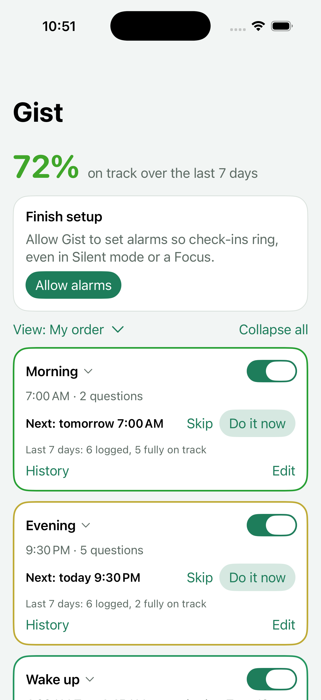

# Gist — an un-dismissable daily diet check-in

Android alarms that ring on your schedule and won't stop until you complete the check-in's
steps: **solve math problems, scan a QR code / barcode, answer yes/no questions**
about what you ate, in whatever order you choose. Each step is optional, so a check-in can be a plain hard-to-dismiss
wake-up alarm, a diet survey, or both. You can have as many check-ins as you like. It keeps a simple log so you can see the *gist* of your
diet without counting calories.

- **Two small dependencies**, both open-source plain Java (Apache-2.0):
  [ZXing core](https://github.com/zxing/zxing), a barcode decoder, for scanning; and
  [SnakeYAML Engine](https://bitbucket.org/snakeyaml/snakeyaml-engine), a YAML parser,
  for backup files. Everything else (camera, UI, storage, video) uses Android's built-in
  APIs. There's no AndroidX and no Google Play services. SnakeYAML Engine stays on 2.x
  on purpose: 3.x needs Java 11 library methods that Android 10–12 don't have.
- **No internet permission.** Nothing ever leaves your phone. Answers live in the app's
  private storage, and the only way out is the **Export CSV** button.
- About 4,900 lines of Kotlin in 28 files, with no generated code.

<p>



</p>

## Build & install

1. Install [Android Studio](https://developer.android.com/studio).
2. **File → Open** → choose this `Gist` folder. Let Gradle sync. Android Studio downloads
   Gradle and the Android SDK itself. If it offers to upgrade the Android Gradle Plugin,
   accepting is fine.
3. On your phone: **Settings → About phone → tap "Build number" 7 times** to enable
   Developer options. Then turn on **Developer options → USB debugging**.
4. Plug the phone in, pick it in the device dropdown, and press **Run ▶**.

Requires Android 10 or newer.


## Security & dependency checks

- **Dependabot** (`.github/dependabot.yml`) opens a pull request each week when a library
  or GitHub Action has an update or a security fix. The PR runs the full test suite.
- **CodeQL** (`.github/workflows/codeql.yml`) scans the Kotlin code and the workflows
  for security issues on every push and weekly. Results are under **Security → Code scanning**.
- **Security report** (`.github/workflows/security-report.yml`, Mondays) checks:
  - outdated build tools, libraries and Actions, including Actions on old Node.js versions;
  - known vulnerabilities in every resolved dependency, using the free OSV database;
  - open CodeQL alerts.

  If it finds anything, it opens (or updates) an issue labeled `security-report` and
  assigned to the repo owner, and GitHub emails you. It closes the issue when everything
  is clear. Run it any time from **Actions → Security report → Run workflow**.
- For email, keep GitHub's notification emails on (Settings → Notifications → Email).
  Also turn on **Dependabot alerts** under the repo's Settings → Code security; that's a
  repo setting only you can change.

## Builds & releases (GitHub Actions)

- **Every push to `main`** (and every pull request) runs **Build**: a debug APK, unit
  tests, lint, and UI tests on an emulator (see Tests below). The debug APK and all
  logs and reports are attached to the run as artifacts.
- **Release** runs the full Build workflow (all tests) first, then builds a signed APK and
  publishes it as a GitHub release, with a `.sha256` checksum next to it. Start it either way:
  - **Actions → Release → Run workflow**, then enter a version like `v1.0.0`. The tag is
    created on the latest `main` if it doesn't exist. Running it for an existing tag
    rebuilds that release.
  - or push a tag: `git tag v1.0.0 && git push origin v1.0.0`
  Each release run pauses until you approve it (see the signing key setup below).

- **Screenshots** run automatically after each release. An Android emulator on GitHub
  opens the app with demo data and captures the start page, history, a check-in's edit
  page, and the alarm screen (math and questions). The PNGs are attached to the release
  and shown in its notes. If this step fails, the release is still published. To make
  screenshots without releasing, use **Actions → Screenshots → Run workflow** and leave
  the tag empty. To make this possible, *debug* builds let these screens be opened
  directly from the command line (`app/src/debug/AndroidManifest.xml`). The release
  APK you install doesn't.

**When something fails:** compile errors appear as annotations on the run page and on
the exact lines of code. The job summary shows Gradle's "What went wrong" section and
the end of the log. The **build-logs** / **release-logs** artifact has the full Gradle
logs plus the lint and build reports.

### One-time setup: a signing key

Android only installs an update if it's signed with the same key as the installed app,
so releases need one permanent key. You create it once, on your computer, and store it
as secrets in a protected `release` environment. It never needs to be in the repo.

1. Create the key. `keytool` comes with Android Studio, in its `jbr/bin` folder.
   ```
   keytool -genkeypair -v -keystore gist-release.jks -alias gist \
     -keyalg RSA -keysize 4096 -validity 10000
   ```
   It asks for a password and some name fields. The name fields can be anything.
2. Base64-encode it:
   - macOS / Linux: `base64 < gist-release.jks | tr -d '\n' > gist-release.b64`
   - Windows (PowerShell): `[Convert]::ToBase64String([IO.File]::ReadAllBytes("$PWD\gist-release.jks")) | Set-Content -NoNewline -Encoding ascii gist-release.b64`
3. On GitHub, open **Settings → Environments → New environment** and name it `release`.
   - Under **Deployment protection rules**, tick **Required reviewers**, add yourself, and
     **Save protection rules**. Every release run then waits for you to approve it
     (Actions → the run → **Review deployments**) before it can read the signing key.
   - Optionally, under **Deployment branches and tags**, choose **Selected branches and
     tags** and add a tag rule `v*`.
   - Under **Environment secrets → Add environment secret**, add:

   | Secret | Value |
   |---|---|
   | `ANDROID_KEYSTORE_BASE64` | contents of `gist-release.b64` |
   | `ANDROID_KEYSTORE_PASSWORD` | the password you chose |
   | `ANDROID_KEY_ALIAS` | `gist` |
   | `ANDROID_KEY_PASSWORD` | the same password, unless you set a separate key password |

   Add them **only** as environment secrets, not as repository secrets. Any workflow can
   read repository secrets without approval.

4. **Back up `gist-release.jks` and the password** somewhere safe, such as a password
   manager. If you lose them, future releases can't update the installed app, and you'd
   have to uninstall it, which deletes your logged answers. Export a CSV first.

To install a release, open its `.apk` on your phone and allow "Install unknown apps" for
your browser or file manager when Android asks.

## Tests

Two kinds, both run by GitHub Actions on every push to `main` and every pull request.
**Release** runs all of them first and won't publish if any fail.

- **Unit tests** (`app/src/test`, plain JVM, seconds): with several times, the next alarm
  is the soonest one ahead and wraps to tomorrow's first; math problems always have the right
  answer; date rules (before-4 AM rollover, "previous day" check-ins across months and
  years); next-alarm time, including daylight-saving changes; stats; step descriptions; repeat rules (weekdays skip the weekend, monthly on the 1st/last day incl. February and leap years, missing dates skipped, next ring Friday evening → Monday) and their descriptions; the check-in library templates are well formed and copies get free names; background descriptions.
- **UI tests** (`app/src/androidTest`, Espresso + UI Automator on an Android 15
  emulator, a few minutes):
  - multiple times: each time's results are saved separately; History shows ✗ for a day if
    any time was off track or missed and – for skipped days, and fixing one time updates
    it; removing a time re-arms for the rest, and the last time can't be removed;
  - Do it now / Skip: skipping moves the alarm past that ring and Undo restores it; a
    skipped or early-resolved ring stays quiet when its time comes; early scanning has no
    fallback
    the start page switch turns a check-in's alarm off and on
  - pausing: Start check-in silences a real ringing alarm and shows the countdown bar;
    each tap restarts the countdown; when it runs out the alarm rings again and progress
    is kept
  - the alarm screen can't be escaped with Back; Submit stays disabled until every
    question is answered; a wrong math answer gives a new problem; steps run in order;
    two waiting check-ins run back to back; with no camera, the scan step offers the math
    fallback; a check-in with no steps only needs Dismiss
  - steps: they're listed in their order; dragging Questions above Math reorders them; a
    custom order (questions, then math) is what the alarm runs; a step that isn't set up
    (scan without a code) says so and is skipped; adding Math opens its page and the
    difficulty saves; the scan spot name saves; removing a step keeps the others' order
  - edit page: rename saves as you type; add and reorder questions; turning the alarm
    off/on cancels and reschedules the real alarm; Weekdays and Monthly-on-the-1st
    rules save and move the real alarm to the right day; delete
  - History: correct stats, and fixing a day from the grid updates them
  - saving and loading, including data from the first version
  - backup: export → import on a "fresh phone" restores check-ins, step order, answers,
    slideshow photos and video; only the chosen check-ins (and history) are exported;
    importing a check-in you already have can update it (history merged or kept), replace
    it (history too, or none) or add a copy ("Wake (imported)"); unchosen check-ins are
    left alone; the export and import dialogs pass on what you tick; hand-edited YAML
    imports; bad files are rejected without changing anything
  - Light and Dark override the phone's setting
  - a real alarm plays the check-in's chosen sound; Silent plays nothing; a missing sound
    falls back to a default; a photo, a cycling slideshow and a playing (muted) video show
    behind the ringing screen, with the caption; caption-only works; background type,
    slideshow speed and caption save from the edit page
  - library: + Add check-in opens it; adding a template copies it (new id, schedule,
    questions), arms its alarm and opens it; a second copy gets "Water 2"; Create your own
    starts blank
  - leaving a ringing alarm with Home brings it back to the front, both while ringing and
    after Start check-in
  - **end to end:** a real alarm fires while the screen is off, the alarm screen takes
    over, the alarm rings until the question is answered, and the answer is saved

The test libraries are test-only: they're never included in the APK you install.

**When a test fails:** the run page lists it with its message and links to the exact
line of test code. The **ui-test-logs** artifact has the HTML report, a screenshot of
the screen at the moment each UI test failed, and the emulator's full log.

Run them locally from Android Studio, or: `gradle testDebugUnitTest` (no device needed)
and `gradle connectedDebugAndroidTest` (with a phone or emulator connected).

## First run

The main screen shows a **Setup needed** section until everything is granted:

| Permission | Why |
|---|---|
| Notifications | The alarm screen is launched through a notification. |
| Full-screen alarms (Android 14+) | Lets the check-in appear over the lock screen. |
| Alarms & reminders | Rings at the exact minute (usually already granted). |
| Camera (asked when you register a code) | Scanning. Grant it ahead of time, because the alarm screen can't ask for it. |
| Battery optimization off | Samsung, Xiaomi, OnePlus, etc. sometimes kill background alarms. Also see <https://dontkillmyapp.com>. |

Then press a check-in's **Test** button (it rings in 10 seconds) and lock the phone.

## How it works

- **Ringing:** At the chosen time it plays your phone's default alarm sound on the alarm
  stream and vibrates. While it rings, the alarm volume can't go below 80%; if you turn
  it down, it goes straight back up. The original volume is restored afterwards.
- **Several times a day:** A check-in can ring at more than one time (e.g. brushing
  teeth at 7:30 AM and 10:15 PM). On its page, under **Schedule**, use **+ Add time**,
  tap a time to change it, or ✕ to remove it. Each time keeps its own result. Reports
  roll them up per day:
  - **✗** if any time that day was answered off track, **or rang and was never finished**
    (missed);
  - **✓** if every time that rang was answered on track;
  - **–** if every time that day was skipped; **·** if nothing rang.
  On History, tapping a day asks which time to fix (a missed time can be filled in
  afterwards). The CSV has one row per day, check-in and time, with its status.
- **Repeats:** Under **Schedule**, tap **Repeats** to choose which days a check-in
  rings (applies to all its times):
  - **Every day** (the default);
  - **Weekdays (Mon–Fri)** or **Weekends (Sat & Sun)**;
  - **Specific days of the week…**, e.g. Mon, Wed, Fri;
  - **Monthly on certain dates…**, e.g. the 1st and 15th, plus **Last day of the
    month**. A month without the chosen date (the 31st in November) is skipped, so use
    "Last day" for month-end.
  Days it isn't scheduled show **·** on History and don't count against you. The start
  page shows the rule next to the times (e.g. "7:00 AM, Mon–Fri") and the real next ring
  ("Mon 7:00 AM", "Dec 1 9:00 AM"). The **Alarm on** switch still turns the whole check-in
  off and on.
- **Do it now / Skip:** Each check-in card on the start page shows its next ring.
  - **Do it now** runs the same steps right away (math, scan, questions). That ring then
    stays quiet. A scan must really be scanned: the "Can't scan?" fallback isn't offered
    early.
  - **Skip** cancels just that ring. It's only possible before the ring goes off, and
    **Undo** brings it back.
  Both apply to the next ring only.
- **Sound, background and caption per check-in:** On a check-in's page, under **While it
  rings**:
  - **Sound:** any of the phone's sounds, or "Silent" to only vibrate.
  - **Background:** **None**, **One photo**, a **Slideshow of photos** (pick up to 20;
    they cross-fade every 3, 5, 10, 30 or 60 seconds), or a **Video** (up to 30 MB;
    plays muted and loops, so you still hear the alarm). Media is copied into the app
    (photos resized), so deleting the originals doesn't break it.
  - **Caption:** optional text shown in large type on the ringing screen, e.g. "Future
    you says thanks". It works with or without a background.
- **Settings** (button at the bottom of the start page):
  - **Appearance:** same as phone, Light, or Dark.
  - **Export backup…** first asks which check-ins to include (all are ticked) and, for
    each, whether to **include its history**. It saves one `.yaml` file with their
    settings, backgrounds (photos and videos, as base64) and the history you chose. It's
    readable and you can edit it by hand (times are `"HH:mm"`; a comment at the top says
    how to import it). With one check-in the file is named after it, which is handy for
    sharing a check-in.
  - **Import backup…** lists the check-ins in the file. For each one, choose whether to
    import it and whether to **import its history**. If you already have it (same
    check-in, or same name), choose what happens:
    - **Update it:** settings and background from the file, your history kept (plus the
      file's, if you import it; the file wins for the same time on the same day);
    - **Replace it:** the file's version, history included; yours is deleted;
    - **Keep it and add this as a copy**, named e.g. "Wake (imported)".
    Check-ins you don't pick, and ones on the phone that aren't in the file, are left
    alone. Alarms are set right away. A bad or unrelated file is rejected without changing
    anything. Alarm sounds are saved by reference, so if the new phone lacks a sound, that
    check-in uses the default alarm sound.
  - **Export answers (CSV)…**, for spreadsheets.
- **Pause while you work:** While it rings, the alarm screen shows one big **Start
  check-in** button. Tapping it silences the sound and vibration for 30 seconds and shows
  the steps, with a countdown bar fixed at the top of the screen. Every tap or keystroke
  restarts the 30 seconds. If the countdown runs out, even with the app in the
  background, the alarm rings again and the Start screen comes back. Your progress
  (solved problems, answers) is kept.
- **Can't dismiss it:** The check-in screen shows over the lock screen, the Back button
  does nothing, and **Submit** only unlocks once every question is answered. Leaving
  with Home or the app switcher doesn't stop the sound, and the check-in **comes straight
  back to the front** within a second, ringing or paused. Android only lets an app do
  that with **Display over other apps**, so the start page's "Finish setup" card asks for
  it (Gist never draws anything over other apps). Without it, the alarm keeps ringing and
  opening the app takes you straight back to the questions.
- **Safety valve:** After 60 minutes the sound stops so it can't drain your battery.
  The check-in stays pending as a sticky notification until you answer.
- **Steps:** On a check-in's page, **When it rings** lists its steps in the order they
  run. **+ Add step** picks a type; **drag a step by its ≡ handle** above or below the
  others to change the order; **tap a step** to open its own page, where you set it up or
  remove it. A step that isn't set up yet (a scan without a code, questions without any)
  is shown in orange and skipped when the alarm rings. The types:
  - **Math problems:** 1–10 problems at one of four levels: Easy `47 + 38`, Medium
    `47 × 6 + 23`, Hard `47 × 38 + 512`, Very hard `347 × 38 + 47 × 26`. A wrong answer
    gives you a new problem.
  - **Scan a code:** **Register a code** (any QR code or product barcode) and name the
    spot (e.g. "Bathroom sink"). When the alarm rings, only that exact code stops it. If
    you can't scan (you're traveling, the camera fails), a **"Can't scan?"** button
    appears after 2 minutes. It swaps the scan for 5 very hard problems.
  - **Questions:** the yes/no survey: add, edit, reorder and delete questions. These are
    the only answers that get logged.
  A check-in with no steps at all just shows a Dismiss button.
- **Check-ins:** You get **Morning** (7:00 AM, 2 questions about last night) and
  **Evening** (9:30 PM, 5 questions about today) to start with. Rename, change or delete
  them, and add as many more as you like with **+ Add check-in**, which opens the
  **library**: ready-made check-ins grouped by Food (diet gist, last night, water),
  Wake-up (weekday math alarm, gentler weekend one), Health (medication, brush teeth,
  bedtime), Fitness (workout Mon/Wed/Fri, stand & stretch on work days, daily steps,
  Sunday weigh-in), Mind (journal, reading) and Money (monthly money check on the 1st,
  bills on the 15th and last day). Tap **Add** to copy one into your list and open it to
  adjust, or **Create your own** to start blank. Templates live in `Library.kt`. The start page lists
  each check-in with its times, steps and last-7-days stat, an on/off switch at the far
  right of its name, and two buttons:
  - **Edit** opens its own page: name, on/off, repeats and times, "previous day" option,
    sound and background, the steps (each with its own page), a 10-second test, and delete. Changes save as you make them.
  - **History** opens its last 30 days: logged / on-track counts, how often each question
    went off track, and a ✓/✗ grid. Tap a day to fill it in or fix it.
  Backup, CSV export and dark mode are under **Settings** at the bottom of the start page.
- **"About yesterday":** A check-in with this setting (Morning by default) logs its answers
  to the previous day, so last night's late snack lands on the right date. Separately,
  any alarm set before 4 AM also counts as the previous day.
- **Two at once:** If two check-ins are waiting (say you slept through one), the alarm
  screen goes through them one after the other. It stops ringing only after the last one.
- **Fixing mistakes:** Tap any day on a check-in's History page to fill it in or change it.
- **Questions:** Add, edit, reorder, or delete them. Each one says whether "Yes" or "No"
  is on track. That drives the ✓/✗ grid and the "fully on track" counts.
- **Honest limits:** Like Alarmy, it can't stop you from force-stopping or uninstalling
  it in Settings. The friction is the point.

## Files

```
app/src/main/java/dev/gist/checkin/
  MainActivity.kt    start page: setup warnings, check-in list, 7-day stats, CSV export
  HistoryActivity.kt one check-in's last 30 days: stats, per-question counts, day grid
  CheckinEditActivity.kt  one check-in's page: name, schedule, sound, background, steps, questions
  LibraryActivity.kt "Add a check-in": the library of templates, or start blank
  Library.kt         the ready-made check-in templates
  Repeat.kt          repeat rules (every day, weekdays, chosen days, monthly dates)
  Background.kt      background type (none / photo / slideshow / video) and caption
  Backgrounds.kt     stores the background photos and video in the app's private files
  Backup.kt / Yaml.kt  backup file export/import (YAML via SnakeYAML Engine)
  CheckinText.kt     short descriptions of a check-in (time, steps, next ring)
  CheckinActivity.kt the alarm screen: runs the steps in their order, then stops the alarm
  Steps.kt           step types, their order, and what each one needs
  StepEditActivity.kt one step's own page (math level, scan code, questions)
  ReorderList.kt     the drag-to-reorder list on the edit page
  ScannerView.kt     camera preview + on-device QR/barcode decoding (Camera2 + ZXing)
  ScanActivity.kt    registers a code for a check-in
  MathGen.kt         math problem generator
  AlarmService.kt    plays sound/vibration, guards volume, brings the alarm back to the front, 60-min safety stop
  AlarmScheduler.kt  schedules each check-in's alarm with AlarmManager.setAlarmClock
  Receivers.kt       alarm fired → start ringing; reboot/time change → reschedule
  Notif.kt           notification channels + full-screen alarm notification
  Store.kt           check-ins, questions, and answers (SharedPreferences + JSON)
  Days.kt            date helpers
  Ui.kt              tiny helpers for building layouts in code
```

The default check-ins and questions are in `Store.kt` (`DEFAULT_CHECKINS`). You can
change all of it in the app.
